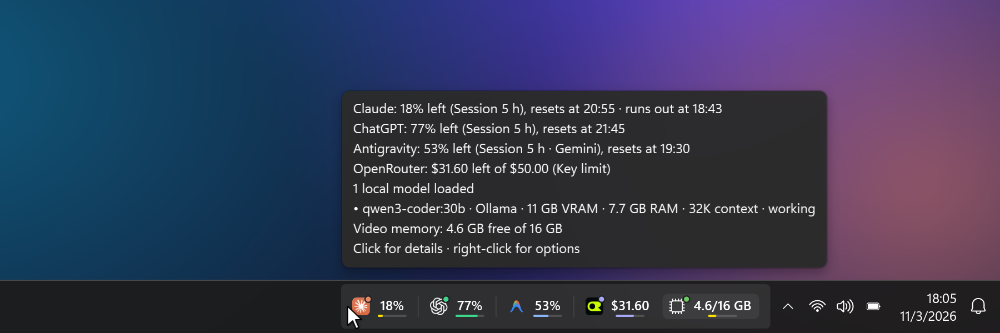
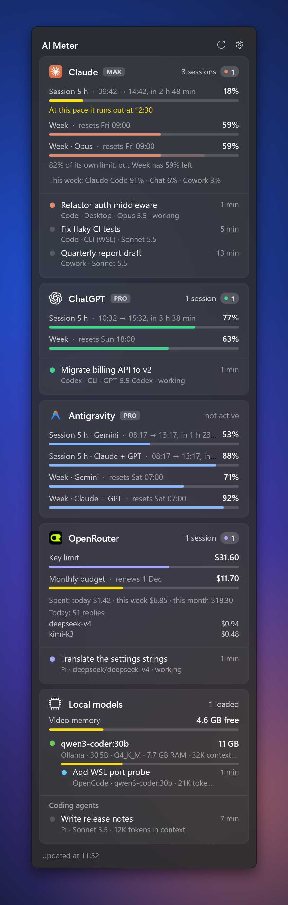
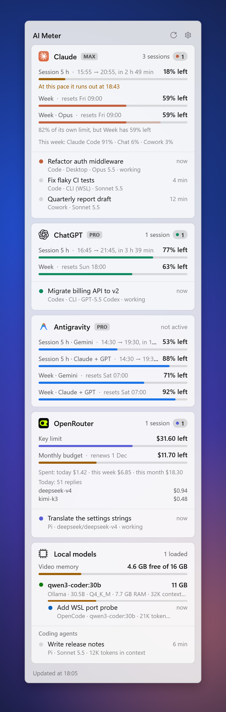
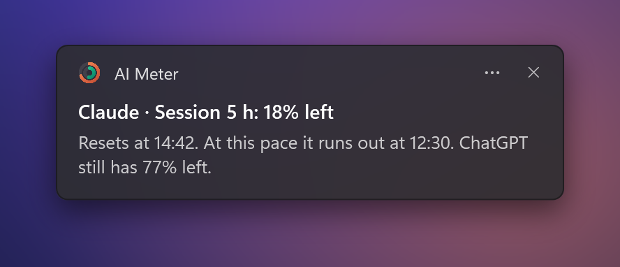
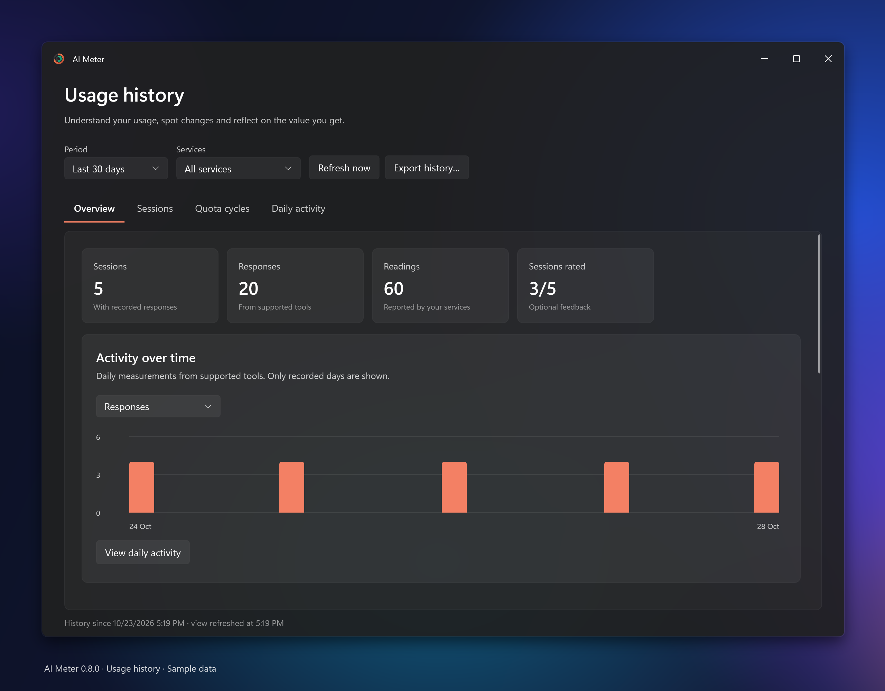
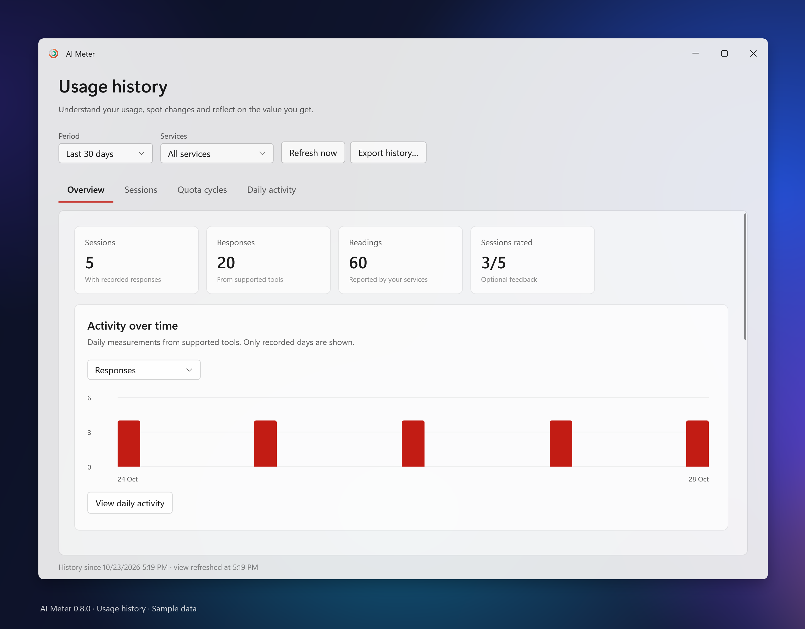
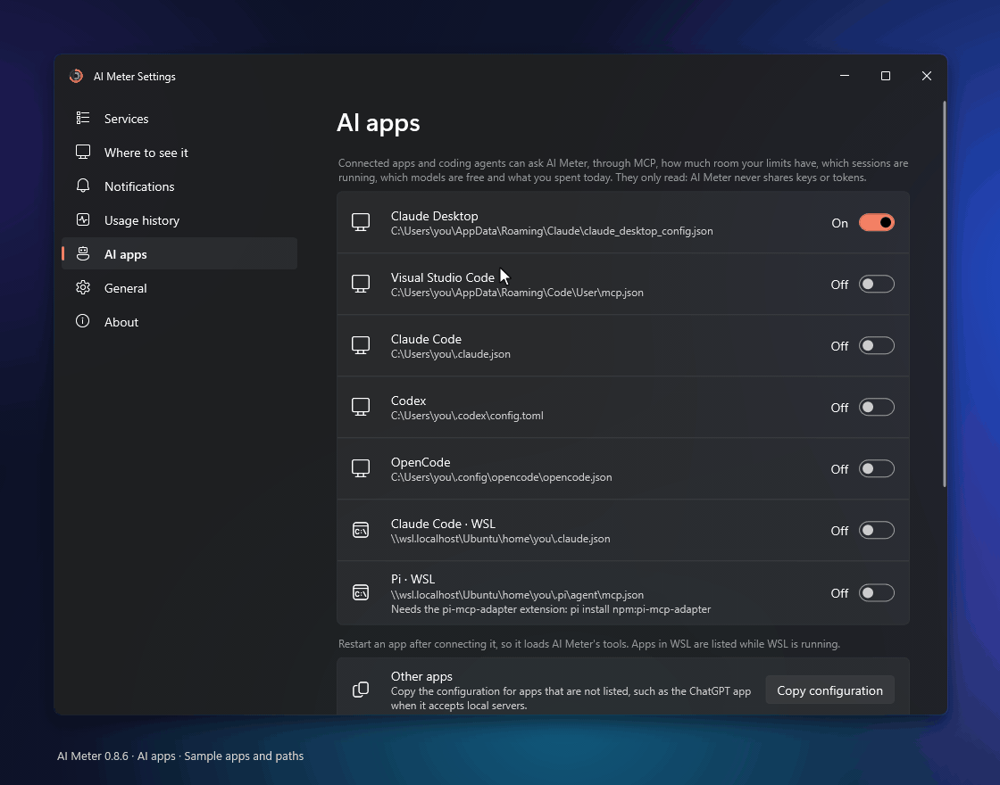
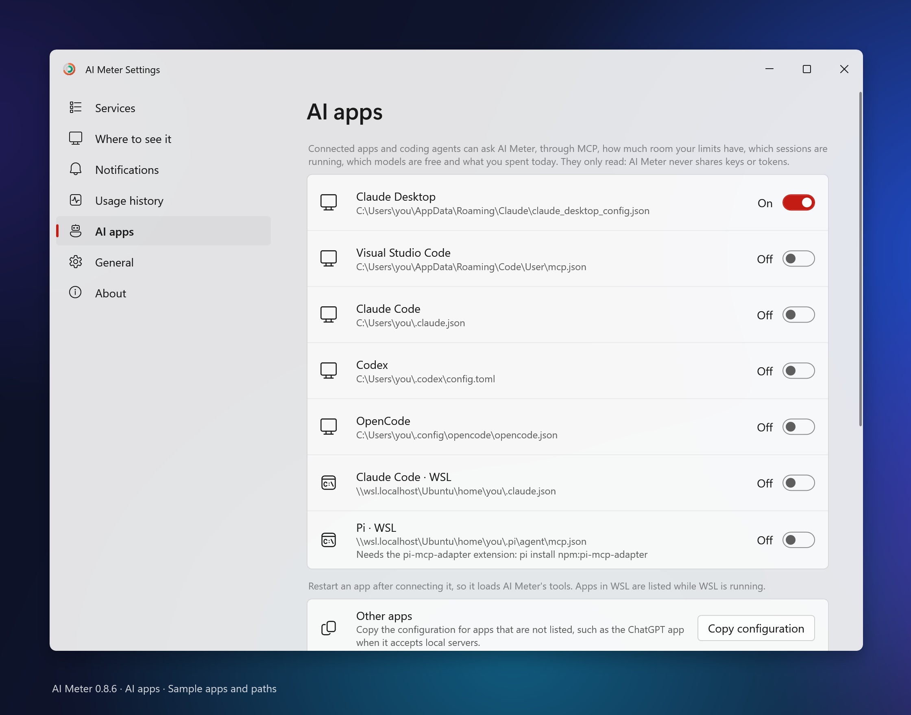

<div align="center">


# AI Meter

**AI limits in your taskbar. A local history of what you use.**

[](https://github.com/dichiara19/ai-meter/releases/latest)
[](#install)
[](LICENSE)
[](#languages)

<a href="https://apps.microsoft.com/detail/9PKMRQWBWHDM"></a>

</div>

<p align="center"></p>

That's all of it, most of the time: a pill **inside** the taskbar. No widget to arrange, no window stuck on top of your work. Hover for the summary, click for everything.

- **Lives in the taskbar.** The pill is part of the taskbar, not a window floating on it: it hides with an auto-hiding taskbar and with full-screen apps, follows the taskbar's light or dark mode and finds the free space for your layout. A desktop widget and a compact overlay are there if you want them.
- **Understand your usage over time.** A local dashboard shows quota cycles, daily activity, models and tools, and signals when recorded consumption changes. Optional session feedback asks whether the useful result was worth the quota or money consumed. [Explore usage history](#your-usage-over-time).
- **Looks like Windows made it.** Fluent design, Mica and Acrylic, your accent color, Windows fonts and notifications, a Settings page built like Windows 11 Settings. Six languages.
- **Practically free to run.** About 0.02% CPU and 120 MB at rest. No Electron, no WebView, no runtime to install: WPF on the .NET Framework already in Windows. Efficiency cores, slower refresh on battery and when nothing is visible, nothing at all while the PC is locked.
- **Windows and WSL, one view.** Claude Code, Codex and other coding agents running in WSL, model servers inside WSL (NAT or mirrored networking), the video memory of the WSL VM: shown next to their Windows counterparts. WSL is never started, and nothing runs inside it except, when a sign-in has expired, the agent's own CLI to renew it.
- **Local models are first-class.** Ollama, LM Studio, llama.cpp, llama-swap, vLLM and more: video memory, context window, how much context the current request uses, requests in flight, and which coding agent (OpenCode, Pi, Gemini CLI, Qwen Code…) is talking to which model.
- **Your subscriptions, before the wall.** Claude, ChatGPT / Codex, GitHub Copilot, Google Antigravity, Cursor, OpenRouter, Cloudflare Workers AI, Vercel AI Gateway, Experiential Labs, DeepSeek, Kimi, plus, for the AI apps you connect, the model lists of NVIDIA API Catalog and Gemini API. For the services with limits: 5-hour and weekly limits, a forecast ("at this pace it runs out at 15:40"), a notification at 20% and 5% that tells you which service still has room, and a tip before a reset when part of a limit would go unused. Pick which limit each service shows in the pill, and get notified whenever the limits you choose reset.
- **Private and open.** No telemetry; the only network requests are each service's own usage endpoint. Apache 2.0 licensed, and a new service is a [20-line JSON file](docs/PROVIDERS.md).

<p align="center"></p>

<table>
<tr>
<td width="50%"></td>
<td width="50%"></td>
</tr>
<tr>
<td colspan="2" align="center"></td>
</tr>
</table>

## Your usage, over time

Open **Usage history** from the notification-area menu or **Settings → Usage history**. AI Meter starts collecting when you first run this version and continues with the panel closed. It keeps the data on your PC, so you can look back without saving prompts or conversation text.

<p align="center"></p>

- **See what you use.** Daily charts and model/tool summaries separate responses, input, output, cache reads, cache writes and tool-computed API costs. Session token records come from Claude Code, Codex, Pi, OpenCode and Kilo on Windows and already-running WSL.
- **Compare quota cycles.** Account identities, limits and resets stay separate. The dashboard shows observed peaks and remaining quota at the last reading; it does not assign an account's consumption to a single session or add overlapping limits together.
- **Spot changes with enough evidence.** Consumption signals compare recorded rates against your own active history. A new archive, a first reading, a missing value and a reported zero have different states. Until there is enough comparable data, the dashboard says so. A signal cannot prove that a provider changed its billing rules.
- **Reflect on value, optionally.** Rate whether the useful result justified the consumption: yes, partly or no. Feedback requests are off by default; you can rate manually, edit or clear a rating. Ignoring a request leaves the session unrated.
- **Keep control of the archive.** Disable collection, inspect storage size, export the retained measurements or delete the history. There is no telemetry, and the archive contains no prompts, response text, session titles or credentials.

<details>
<summary>See the light theme</summary>
<p align="center"></p>
</details>

Screenshots use sample data. Your archive starts from collection time; it cannot recover unobserved provider-side activity. Computed API costs are not subscription charges, and missing counters are not zero. See [data sources, collection limits and feedback behaviour](docs/HISTORY.md).

## Install

**From the Microsoft Store.** [AI Meter - Windows](https://apps.microsoft.com/detail/9PKMRQWBWHDM) is signed by Microsoft, so Smart App Control and SmartScreen trust it, and the Store keeps it updated with stable versions. Install it and the pill appears in your taskbar.

**From GitHub.**

1. Download **AIMeter-script.zip** from the [latest release](https://github.com/dichiara19/ai-meter/releases/latest) and unzip it anywhere.
2. Run **`Start AI Meter.cmd`**. It works with Smart App Control on: Windows PowerShell, signed by Microsoft, compiles and runs the source you can read.
3. The pill appears in your taskbar: AI Meter finds the services on your PC and starts with Windows. In Settings you can add a desktop widget or a compact overlay.

Prefer a single executable? **AIMeter.zip** has `AIMeter.exe` (unsigned for now, see [Code signing policy](#code-signing-policy)).

**Updates.** The Store version is updated by the Store. The GitHub versions check once a day: AI Meter asks GitHub whether a newer stable version exists and, if so, shows a notice with a link to its release page. It never downloads or installs anything: to update, exit AI Meter, replace the files in its folder with those of the new zip and start it again (settings and history stay). Turn the check off, or opt in to betas and release candidates, in Settings → About.

<a id="languages"></a>Available in English, Italian, Spanish, French, German and Portuguese. It follows the Windows display language, or you can pick one in Settings. Translations live in `src/StringsTable.cs` and `src/StringsHistory.cs`: new languages are welcome.

## What you get

| Surface | What it does |
|---|---|
| **Taskbar pill** (default) | A compact pill inside the taskbar of the main monitor, placed in its free space (left corner or next to the notification area, based on how your taskbar is set up). It is a child window of the taskbar, so it hides with an auto-hiding taskbar and with full-screen apps. Local models get their own area at the end: video memory in use, with a dot while a model is working. Hover: summary. Click: full panel. |
| **Notification area icon** | Click: full panel (Acrylic, like Windows' own flyouts). Right click: menu. Never shows up in the taskbar. |
| **Desktop widget** | Off by default. Always stays *below* your windows, like part of the wallpaper. Compact cards; click a card header to show its sessions. Drag it by its header. |
| **Compact overlay** | A tiny always-on-top pill (off by default) with two micro buttons: collapse to a live ring icon, or close. Never steals focus, hides itself during full-screen games, videos and presentations, shows details on hover. |
| **Settings** | Built like Windows 11 Settings: connected services, what to show, where, start with Windows, theme, refresh rate, live resource usage. |
| **AI apps (MCP)** | Claude Desktop, Claude Code, Codex, Antigravity CLI, Hermes, OpenCode, Pi, Cursor and VS Code can read your limits, running sessions, free models and today's spending through AI Meter's MCP server, which changes nothing except its own `leases.json` when coding agents lease capacity. Connect each one with a switch in Settings → AI apps. [Details](docs/MCP.md). |
| **Delegation (preview)** | A plugin for Claude Code and Codex hands self-contained tasks to a coding agent you already have (Pi or OpenCode) on a free model that AI Meter finds has room. Read-only by default; changes go to a new Git worktree. [Details](plugins/ai-meter/README.md). |
| **Usage history** | Local quota cycles, spending, session tokens, models and tools, daily totals and consumption signals. Optional feedback records whether the result was worth the consumption. Open from the notification-area menu or Settings → Usage history. |

<p align="center"></p>

<details>
<summary>See the AI apps page in the light theme</summary>
<p align="center"></p>
</details>

For each service: remaining share of the **5-hour** and **weekly** limits with reset times, plus the active sessions with title, model and status.

**Reading the values.** Every surface says what is left, in the limit's own unit: a percentage for quotas ("18% left"), money for credit limits ("$0.73 left of $15.00"; the pill shows just "$0.73") and free memory out of the total for local models ("4.6/16 GB"). Bars show the same thing. In **Settings → Where to see it** you can show what is used instead, or credit limits as a percentage. Notifications always say what is left, since they warn that a limit is running out.

**Forecast and notifications.** At the current pace, AI Meter tells you when a limit will run out if that happens before it resets ("At this pace it runs out at 15:40"), in the panel, in tooltips and with a yellow bar in the pill. The pace is the trend of the last hour and a half of readings, or the average since the window started. Windows notifications arrive when a limit drops below 20% and 5%, with the forecast and the other service that still has room ("ChatGPT still has 80% left"), and when a limit you had almost used up is available again. Each one comes once per window, follows Do not disturb, and can be turned off in Settings.

**Local history.** Collection starts when AI Meter first runs this version and continues with the panel closed. Readings retain their source, time, account scope and data quality; cached snapshots do not become new measurements. Supported local logs supply input/output/cache counters and tool-computed costs, while provider quotas stay account-wide. Feedback is off by default and measures useful output relative to consumption; ignoring it leaves a session unrated. Export, deletion, storage size and collection controls are in the dashboard and settings. See [history behaviour and limitations](docs/HISTORY.md) and [history architecture](docs/ARCHITECTURE.md).

## Where the data comes from

Session information is read from files and databases the AI apps already write. Live quota and balance readings use each enabled service's own usage endpoint. You can turn those connections off; nothing is sent to AI Meter's authors.

- **Claude**
  - Claude Code sessions (desktop app, CLI, also inside WSL, VS Code): `~/.claude/sessions`, titles and models from the Claude desktop app metadata.
  - Cowork tasks and whether the Claude app is open.
  - Limits **in real time** from your account's usage endpoint, using your existing Claude Code login. The token never leaves your PC except to call Anthropic, and it is refreshed by the Claude Code CLI itself: AI Meter never touches the refresh token. Without a login it falls back to the last value saved by the Claude app.
  The panel shows the 5-hour session with its start and end time, weekly and per-model weekly limits, cloud session credits, extra usage credits and how the week splits between Claude Code, chats and Cowork.
- **ChatGPT / Codex**: active Codex threads (app, CLI, VS Code) from Codex's local logs. Limits **in real time** by asking the installed `codex` program (`codex app-server`, JSON-RPC `account/rateLimits/read`): Codex uses its own login, AI Meter never reads or refreshes its tokens. Includes credits and free limit resets. If Codex is not available, the last value in its logs is used.
- **GitHub Copilot** (off by default): premium requests and monthly quotas from GitHub's Copilot usage API. You sign in to GitHub from AI Meter with a device code; the token is encrypted with Windows Data Protection (DPAPI) for your user only. GitHub shows the request as "Visual Studio Code", the official Copilot app that can read quotas.
- **Google Antigravity** (off by default): the 5-hour and weekly quotas of your Google AI plan, per model group (Gemini, Claude + GPT), from the API Antigravity itself uses. AI Meter reads the sign-in of Antigravity CLI (on Windows or in WSL, only while WSL is running) and never renews it: when it expires, it asks the CLI to (`agy models`, at most every 30 minutes). The Gemini app does not expose its limits, so they are not shown.
- **Services described by a definition file** ([`providers/`](providers), format in [docs/PROVIDERS.md](docs/PROVIDERS.md)):
  - **Cursor**: included usage and on-demand spend for the billing cycle, from cursor.com, using the sign-in the Cursor app already keeps on your PC (read from its local database with the SQLite library built into Windows). AI Meter never refreshes or stores that token and never reads browser cookies.
  - **NVIDIA API Catalog** and **Gemini API** (off by default): the models your key can use, with their token limits where the service gives them, for the AI apps you connect. Neither service lets a key read its limits or say which models are free on your account. They are therefore model catalogues: listed in Settings under *Model catalogues for AI apps*, never on the taskbar, panel or widget, and their models are reported to AI apps as models whose price is not stated.
  - **OpenRouter**: spending and limit of your API key. **Experiential Labs**: credits used and left. **Vercel AI Gateway**, **DeepSeek** and **Kimi (Moonshot)**: account balance. For all of them: spending by day, week and month, optional spending budgets, and the models your agents (OpenCode, Pi) used today, with cost and tokens. Period totals reported by the service support budget bars and notifications. Spending derived from sampled totals or balances is labelled as an estimate with its observation start; a first reading is unavailable, and estimates do not imply remaining budget or trigger forecasts and threshold alerts. If a program on your PC already uses the key (OpenCode, Pi, Crush, Hermes's `.env`, or an `export` in your shell profile, on Windows or in WSL), AI Meter uses it from there; otherwise you paste one in Settings (or set the usual environment variable), encrypted with Windows Data Protection. Settings says which key is in use, and finding keys can be turned off.
  - **Cloudflare Workers AI**: the Neurons used today against the free 10,000 a day, which reset at midnight UTC, from Cloudflare's GraphQL Analytics API. It needs an API token with the *Account Analytics: Read* permission and the account ID. *Create a key* in Settings opens Cloudflare's token page with that read-only permission already filled in. AI Meter takes them from OpenCode, Pi or Hermes when they already use Workers AI (OpenCode keeps the account ID beside the key when its `/connect` saved it, Hermes in its `.env`), from `CLOUDFLARE_API_KEY` and `CLOUDFLARE_ACCOUNT_ID` on Windows or exported in your shell profile, or pasted in Settings. A token made only to run models may lack the analytics permission: the card then says so. Cloudflare's analytics can lag a few minutes and are not its billing figures, so near the limit Cloudflare's own answer decides.
  - *These have been tested against recorded API responses, not yet with real accounts: reports are welcome.*
- **Local models**: AI Meter looks for model servers listening on this PC and recognises them from their own API: Ollama, LM Studio, llama.cpp `llama-server` (also in router mode), llama-swap, vLLM, KoboldCpp, LocalAI and text-generation-webui. For each loaded model it shows video and system memory, the context window, requests in progress and how much context the current request uses, when the server tells. Servers inside WSL are found only while WSL is already running (`ss` inside the distribution, at most once a minute); video memory comes from the Windows GPU counters (in WSL it is all charged to the WSL virtual machine). Only `127.0.0.1` is contacted, and only with read requests that never load a model.
- **Coding agents**: sessions active in the last 30 minutes of OpenCode, Kilo, Pi, Hermes, Gemini CLI, Antigravity CLI, Qwen Code, Goose, Crush and Cline CLI, read from their local session files and databases (Windows and WSL), with title, model, context in use (not for Antigravity CLI, which does not record it in plain form) and whether the agent is working. Pi runs that keep their sessions elsewhere (`--session-dir`, `PI_CODING_AGENT_DIR`, also from scripts or inside a `bwrap` sandbox) are found through the running process: its arguments on Windows, `\\wsl.localhost\<distro>\proc` in WSL while it is running. A session that uses a model loaded locally is shown under that model; a Pi session on a service with a card (OpenRouter, Experiential Labs, Claude…) is shown on that card. Long session lists fold behind a count.
- Individual claude.ai / ChatGPT chats leave no trace on disk, so for those you only see whether the app is open.
- Service logos are read at runtime from the apps installed on your PC. When an app is missing, AI Meter shows the official logo that GitHub (Copilot) and OpenAI (ChatGPT, Codex) publish to identify their services, bundled as published, as it does for the API services; Claude then shows its initial, since Anthropic allows its logo only with permission. Logos are trademarks of their owners, used only to identify each service; see [NOTICE](NOTICE).

## Resource usage

Taskbar-view baseline measured on a Windows 11 laptop before the history dashboard was added:

| | |
|---|---|
| RAM | ~100 MB as executable, ~125 MB private with the PowerShell launcher |
| CPU at rest | ~0.016% of the machine (0.26% of one core) with the taskbar pill, Claude, Codex and a local model server in WSL |
| GPU | 0% (software drawing; Mica/Acrylic composed by Windows) |

These figures are a baseline for the taskbar view. Opening the dashboard or processing newly written session logs adds work; memory and query time also depend on the retained history. Collection remains incremental and uses the existing background worker.

How:
- WPF on .NET Framework 4.8, already part of Windows: no runtime to install, no browser engine.
- Software drawing: no Direct3D device on the GPU.
- No continuous animations: the window is redrawn only when something changes.
- Data collection runs on a low-priority thread with **EcoQoS** (efficiency cores). Refresh every 10 s while the panel or Settings are open, every 30 s when only the pill, widget or overlay are visible, twice as slow on battery or Energy Saver, 120 s when nothing is visible, and **stopped** while the PC is locked or asleep. A refresh takes about 50 ms.
- The taskbar pill checks every 2 s, with two window-position reads, whether the taskbar moved; it repositions itself only when something changed.
- Files are read only when they change, large logs only from their tail, and only the needed fields are cached.
- **WSL is never started**: it is read only if its VM is already running, and listening ports are read from the kernel's TCP table as a file. The only process launched inside it is the CLI of Claude Code or Antigravity, to renew its own expired sign-in (`claude auth status`, `agy models`), so that AI Meter never handles refresh tokens. AI Meter asks Windows which distributions are running at most once a minute.
- Local model servers are contacted only on `127.0.0.1`; a port that does not answer HTTP is dropped after one short request. GPU memory is read with PDH only while a local server runs.
- The Claude limit is fetched over the network every 5 minutes (15 on battery), only while something is visible.
- Full-screen detection is event-driven, not polled.

## Download files

From the [latest release](https://github.com/dichiara19/ai-meter/releases/latest):

- **AIMeter.zip**: unzip and run `AIMeter.exe`.
- **AIMeter-script.zip**: if Smart App Control blocks the unsigned executable, unzip and run `Start AI Meter.cmd`, which starts the same app from source with Windows PowerShell.

Pre-releases (`vX.Y.Z-beta.N`, `vX.Y.Z-rc.N`) are on the [releases page](https://github.com/dichiara19/ai-meter/releases) for anyone who wants to test them; the latest release and the update notice only ever point to stable versions. How versions are cut: [docs/RELEASING.md](docs/RELEASING.md).

The [Microsoft Store version](https://apps.microsoft.com/detail/9PKMRQWBWHDM) is signed by Microsoft and updated automatically by the Store, with stable versions only. How it is built and submitted: [docs/STORE.md](docs/STORE.md).

## Build and install

```powershell
powershell -ExecutionPolicy Bypass -File build.ps1
```

Compiles with the `csc.exe` that ships with .NET Framework (no SDK needed), installs to `%LOCALAPPDATA%\Programs\AI Meter`, adds a Start menu shortcut and updates any existing startup registration to the installed copy. On first use the welcome window asks whether to start with Windows (on by default); startup is registered only after that window closes, if no registration exists (you can turn this off later in Settings). Launching another copy preserves existing startup entries, including those disabled in Windows. `-NoInstall` only builds into `bin\`.

Two install modes:

- **`-Mode script` (default).** Installs the source with the `AIMeter.ps1` launcher. Windows PowerShell, which is signed by Microsoft, compiles the C# code in memory at startup (about 2 s) and runs it, without a console window (`conhost --headless`). This works with **Smart App Control on**, at the cost of roughly 45 MB more RAM.
- **`-Mode exe`.** Installs the compiled `AIMeter.exe`. Lighter, but with Smart App Control on Windows blocks it until releases are signed (see [Code signing policy](#code-signing-policy)).

`-Package` also builds the MSIX package for the Microsoft Store (`bin\AIMeter.msix`, needs the Windows SDK; see [docs/STORE.md](docs/STORE.md)).

Command line: `--settings` opens Settings of the running instance and `--gpu` draws with the GPU.

## Uninstall

Settings → turn off *Start with Windows*, choose *Exit* from the menu, then delete `%LOCALAPPDATA%\Programs\AI Meter`, `%APPDATA%\AIMeter`, the *AI Meter* shortcuts in the Start menu and in the Startup folder, and the registry key `HKCU\Software\Classes\AppUserModelId\AIMeter.App` (name and icon of its notifications).

## Project layout

```
src/Native.cs          Win32: processes (Toolhelp), DWM, EcoQoS, power state, full-screen detection
src/Probe.cs           shared probe (processes, WSL, file cache) and the collector that runs each service
src/ProviderClaude.cs  Claude: Claude Code and Cowork sessions, usage API
src/ProviderCodex.cs   ChatGPT / Codex: threads from local logs, limits via codex app-server
src/ProviderCopilot.cs GitHub Copilot: device-code sign-in, quotas API
src/ProviderAntigravity.cs Google Antigravity: quota groups with the Antigravity CLI sign-in
src/Model.cs           data model and JSON helpers
src/ProviderDefined.cs services described by JSON definitions: requests, spending and response mapping
src/ServiceDefinition.cs JSON service definitions and their loader
src/JPath.cs           dotted-path lookups in JSON responses
src/ApiKeys.cs         API keys encrypted with Windows DPAPI
src/ApiKeyWindow.cs    API key prompt
src/Sqlite.cs          read-only SQLite reader for local agent databases
src/ProviderLocal.cs   local model servers: discovery on Windows and WSL, loaded models, memory, context
src/CodingAgents.cs    sessions of terminal coding agents (OpenCode, Pi, Gemini CLI, Antigravity CLI, …)
src/RunningAgents.cs   session folders named by running Pi processes (Windows and WSL /proc)
src/McpServer.cs       MCP server on a per-user named pipe, with its tools (only leases write)
src/McpClients.cs      AI apps that can use it, their config edits, and the mcp.ps1 relay they start
src/JsonText.cs        indented JSON for config files and MCP tool text
src/GpuMemory.cs       video memory per process from the Windows GPU counters
src/Forecast.cs        when each limit runs out at the current pace; low-limit and reset notifications, tips
src/HistoryCollector.cs incremental, read-only local usage capture
src/HistoryStore.cs    transactional history, feedback, export and deletion
src/HistoryDatabase.cs parameterised Windows SQLite connection
src/HistoryAnalysis.cs read-only history summaries
src/ConsumptionAnalysis.cs quota intervals, personal reference ranges, readiness and evidence
src/ConsumptionAlerts.cs unusual-consumption episodes, notices and overlapping sessions
src/HistoryWindow.cs   native history dashboard
src/HistoryVisuals.cs  settings-style cards, charts and explicit data states
src/StringsHistory.cs  history translations
providers/*.json       built-in service definitions
plugins/ai-meter/      delegation plugin for Claude Code and Codex (Node, separate from the app)
agents/*.json          built-in coding agent definitions: folders, keys and how delegation starts them
src/AgentDefinitions.cs loads agents/*.json and %APPDATA%\AIMeter\agents
tools/render-media.ps1 regenerates the README images (docs/media) from the real UI with demo data
tools/render-store.ps1 renders the Microsoft Store screenshots in six languages (tools/StoreScreenshots.cs)
src/Settings.cs        preferences and start with Windows
src/PackageStartup.cs  start with Windows in the Microsoft Store package (StartupTask)
src/UpdateCheck.cs     daily check for a newer GitHub release (zip and script builds) and SemVer comparison
src/StoreUpdates.cs    in the Store package, whether the Store has an update waiting
src/Theme.cs           Fluent light/dark tokens, Windows accent color, control styles
src/Ui.cs              text, icons, formatting and limit selection shared by every surface
src/UiLogos.cs         service logos from installed apps or bundled assets
src/UiPill.cs          taskbar pill rows and ring icon
src/UiCards.cs         bars, usage and session rows, service and local-model cards
src/UiWindows.cs       Fluent window chrome and Mica backdrop
src/Surfaces.cs        desktop widget, overlay pill, panel
src/SettingsWindow.cs  Settings window and section navigation
src/SettingsWindow.Services.cs Settings: service list and service pages
src/SettingsWindow.Pages.cs Settings: display, notifications, history, general and about pages
src/SettingsWindow.Controls.cs Settings-style rows, toggles and lists
src/Program.cs         entry points, single instance and startup
src/Controller.cs      services, refresh loop, settings and system events
src/ControllerSignIn.cs sign-in and API keys for each service
src/ControllerSurfaces.cs panel, pills, desktop widget and windows
src/ControllerTray.cs  notification icon, menu and notifications
src/Strings.cs         translation engine (English text as key, Windows language or user choice)
src/StringsTable.cs    translations: Italian, Spanish, French, German, Portuguese
assets/app.ico         app icon (generated by build.ps1)
```

## Code signing policy

> Current releases are **not signed**. The project plans to apply for free open source code signing once it has broader adoption; this policy describes how signed releases will be produced.

- Releases are built only by the [GitHub Actions workflow](.github/workflows/build.yml) of this repository, from the tagged source. No binary is built or uploaded by hand.
- Every signing request is approved manually.
- Committers and reviewers: [dichiara19](https://github.com/dichiara19)
- Approvers: [dichiara19](https://github.com/dichiara19)
- Contributions from people outside the team (pull requests) are reviewed by a team member before merge, with particular attention to build scripts and CI configuration.

## Privacy policy

AI Meter does not collect, store or send any data to its authors, and contains no telemetry or analytics. Its only request of its own is the update check described below, which you can turn off.

It reads local files written by the AI apps and coding agents on your PC and keeps its own settings in `%APPDATA%\AIMeter`, on your PC only.

Local usage history is enabled by default. Its SQLite archive contains quota/spending readings, supported session token metrics, tool-computed costs and optional feedback. It stores no prompts, response text, source code, session titles, raw identifiers or authentication tokens. Account/session fingerprints remain local. Disable collection in Settings → Usage history; export or delete retained history from the dashboard. [Storage, data sources and limits](docs/HISTORY.md).

Network connections are limited to reading your own usage:

- **Claude limits** (on by default): a request to Anthropic's API (`api.anthropic.com`) with the OAuth access token of your existing Claude Code login. Governed by [Anthropic's privacy policy](https://www.anthropic.com/legal/privacy). You choose it on the first-launch screen and can turn it off in Settings → Services → Claude → *Real-time limits*.
- **Codex limits**: requested by the installed `codex` program with its own login; AI Meter never handles that token.
- **GitHub Copilot quotas** (off by default): a request to `api.github.com`, only if you enable Copilot and sign in to GitHub.
- **Google Antigravity quotas** (off by default): requests to `cloudcode-pa.googleapis.com`, only if you enable Antigravity, with the sign-in of Antigravity CLI.
- **Cursor usage**: a request to `cursor.com` with the Cursor app's own sign-in, only if Cursor is enabled.
- **NVIDIA API Catalog, Gemini API**: every six hours, a request for the model list to `integrate.api.nvidia.com` or `generativelanguage.googleapis.com` with your API key (in a header, never in the address), only if you turn the service on and a key is added or found on the PC.
- **Cloudflare Workers AI**: a request to `api.cloudflare.com/client/v4/graphql` every 10 minutes with your API token and account ID, only if you turn the service on and a token is added or found on the PC. Every 12 hours, while it is on and its usage can be read, AI Meter also reads Cloudflare's model list from `models.dev`'s public catalogue, with no key or token.
- **OpenRouter, Vercel AI Gateway, Experiential Labs, DeepSeek, Kimi**: a request to `openrouter.ai`, `ai-gateway.vercel.sh`, `api.experientiallabs.ai`, `api.deepseek.com` or `api.moonshot.ai` with your API key, only if you turn the service on and a key is added or found on the PC. For OpenRouter and Experiential Labs, AI Meter also reads the model list every six hours to show the free models (OpenRouter's is public and gets no key; Experiential Labs' needs the key). When a list names a model's Hugging Face repository, as OpenRouter's does, AI Meter asks `huggingface.co`'s public API once, with no key, for the number of parameters in its weights, which orders delegation candidates; the answer is kept in `%APPDATA%\AIMeter\model-sizes.json`, and a repository that gives none is asked again after a week. Only the repository's name is sent. Click the free models count to list them all; a click on a model copies its id. Keys saved by other programs are looked for only if you allow it on the first-launch screen or in Settings → Services; a key found there is read where it is, never copied, and sent only to its own service; values that are commands (`!…` in Pi) are never run.
- **Definitions you add**: a request to the address named in the file.
- **Local models**: requests to `127.0.0.1` only, which never leave the PC.
- **Update check** (on by default, Settings → About → *Check for updates*): in the zip and script builds, at most once a day, one anonymous request to `api.github.com` for the latest release of AI Meter (`/repos/dichiara19/ai-meter/releases/latest`, or the list of recent releases if you include pre-releases). It sends no cookies, account, identifier or version, only the `User-Agent: ai-meter` header that GitHub requires, and like any request it reveals your IP address to GitHub ([GitHub's privacy statement](https://docs.github.com/site-policy/privacy-policies/github-general-privacy-statement)). If a newer version exists it shows a notice; it never downloads or installs anything, and offline or rate-limited checks fail silently. The Microsoft Store version never contacts GitHub: with the same switch on, it asks the Microsoft Store through Windows whether an update is waiting, and the Store installs updates itself.
- **Delegation (MCP)**: coding-agent plugins can reserve room on a free model's pool through AI Meter. AI Meter keeps these leases in `%APPDATA%\AIMeter\leases.json`: pool, model, agent, times and the counts the plugin reports (requests, rate limits, tokens, cost), for 30 days, per pool and per model; each model's counts are its track record, which orders the candidates. The models you mark as preferred or avoided for delegation are kept in the settings. It never stores task text, code or keys, and it starts no agent itself. The [delegation plugin](plugins/ai-meter/README.md#privacy) keeps each task's text and the agent's output in `~/.aimeter/jobs` on your PC for seven days.
- **AI apps (MCP)**: apps you connect in Settings → AI apps read AI Meter's latest data through a named pipe that only your Windows user can open. An app can ask for newer data. AI Meter then reads your usage again from the same services listed above, at most once a minute per service. Nothing else leaves the PC because of it, but what an app reads can reach that app's model provider as part of your conversation. Keys, tokens and account identities are never shared; session titles only if you turn on *Share session titles*.

With these off, AI Meter makes no network connections at all.


## Contributing

Bug reports, translations, new services and code are welcome: see [CONTRIBUTING.md](CONTRIBUTING.md). Questions and ideas go to [Discussions](https://github.com/dichiara19/ai-meter/discussions), security issues to a [private report](SECURITY.md). Everyone is expected to follow the [code of conduct](CODE_OF_CONDUCT.md).

## Support

AI Meter is free and open source, and it stays that way. If it is useful to you and you would like to chip in, you can [buy me a coffee](https://buymeacoffee.com/giuseppedichiara); a star or a bug report helps just as much.

[](https://buymeacoffee.com/giuseppedichiara)

## Third-party services

AI Meter is an independent project, not affiliated with, endorsed or sponsored by Anthropic, OpenAI, GitHub, Microsoft, Anysphere (Cursor) or any other service it shows. Names and logos belong to their owners (see [NOTICE](NOTICE)); logos are read at runtime from apps installed on your PC, and screenshots show them only to identify the services.

Some of the usage data comes from endpoints that the services use in their own apps but do not document publicly. They can change or stop working at any time, and AI Meter reads them only for your own account, with the sign-in those apps already have. You are responsible for using each service according to its terms.

## License

Copyright 2026 Giuseppe Gabriele Di Chiara. Licensed under the [Apache License 2.0](LICENSE); versions up to 0.3.1 were released under the MIT License.

The name "AI Meter" and its logo are trademarks and are not covered by the license: forks and modified builds need their own name and icon, see [TRADEMARKS.md](TRADEMARKS.md).
